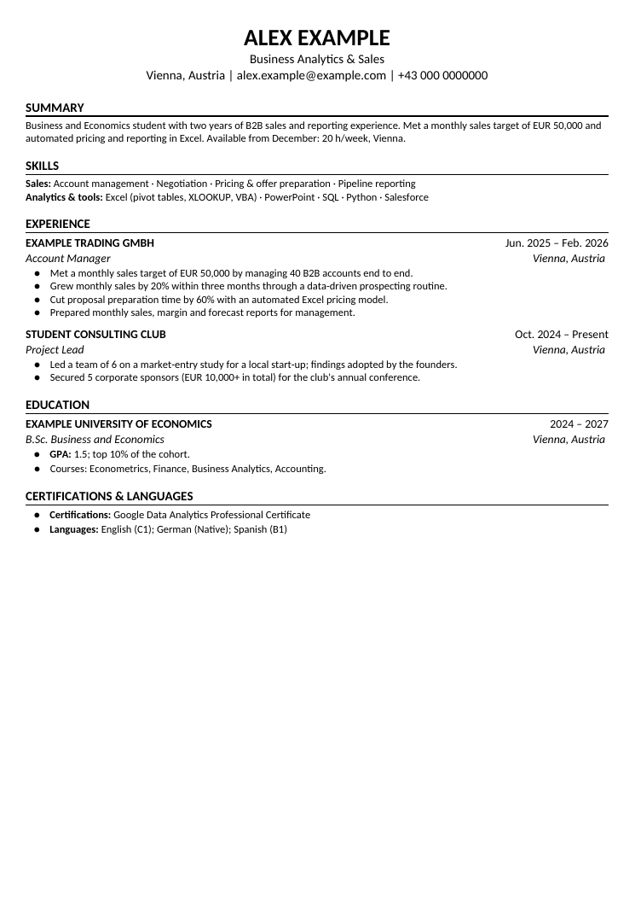
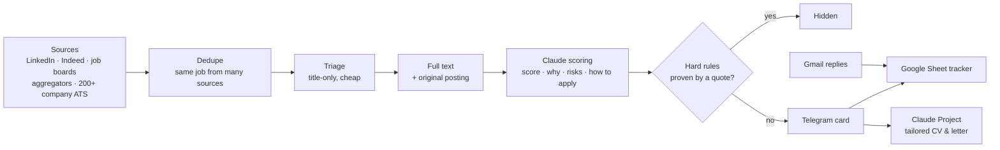

# Job Radar

**A personal job-search assistant that watches 200+ job sources around the clock, has Claude read every new posting against your profile, and sends only the jobs that fit to your Telegram within minutes. It also tracks your applications, reads your inbox for replies and builds a tailored one-page CV for every application.**

[](https://github.com/fedor850/job-radar/actions/workflows/ci.yml)
[](LICENSE)


Job Radar was built for one real search: a business student in Vienna who needed a ≤ 20 h/week job in English.
Everything that is specific to that person lives in two private files, `config.yaml` and `profile.md`. Everything
else is this repository. To use it for your own search, write your own two files and point the sources at your
city ([docs/adapting.md](docs/adapting.md)).

> **Status:** v1.1. It has run in production every day since October 2026. The built-in sources and language rules
> are tuned for **Vienna / Austria**; [docs/adapting.md](docs/adapting.md) shows how to point it at another place.

---

## What it does

| | |
|---|---|
| **Finds jobs fast** | Polls LinkedIn, Indeed, national job boards, aggregators and ~200 company career sites (Workday, SuccessFactors, Greenhouse, Lever, SmartRecruiters, Personio, …) every 4–6 minutes. New employers are discovered automatically. |
| **Reads every ad like you would** | Claude (Haiku) scores each posting 0–100 against your profile and explains *why it fits*, the *risks*, what the ad *does not say*, and *exactly which documents* the employer asks for. |
| **Never rejects on a guess** | A job is hidden only by a hard rule (too many hours, language level, seniority, location, expired…) **backed by a word-for-word quote from the ad** that code verifies. Unproven suspicions are shown to you instead of being silently dropped. |
| **Telegram cards with one-tap actions** | Apply on the company's own site, find alumni/recruiters on LinkedIn for a referral, mark *applied* / *saved* / *not interested (why)*. The bot learns from your reasons. |
| **Application tracker** | A Google Sheet (funnel, statuses, feed of all sent jobs) that updates itself. |
| **Inbox watcher** | Reads Gmail (through your own Apps Script), recognises confirmations, rejections, tests, interviews and offers, updates the tracker and adds interviews to your calendar. |
| **Follow-ups** | Reminds you after 7 days without a reply and drafts the follow-up e-mail. |
| **Tailored CV and cover letter** | A builder makes a one-page, ATS-friendly CV and cover letter (DOCX + PDF) from JSON, and a ready-made Claude Project workflow writes that JSON for each job ([claude-project/](claude-project/)). |
| **Runs by itself** | A €5/month Linux server, systemd, a watchdog that restarts and alerts, daily backups, alerts when a source breaks or the AI budget runs low. |

<p align="center"></p>

## How it works



More detail: [docs/architecture.md](docs/architecture.md).

## Quick start

You need about one hour and no programming. Every step is explained in **[docs/getting-started.md](docs/getting-started.md)**.

1. **Accounts:** a Telegram bot (free, @BotFather), a Claude API key (pay-as-you-go), and a small Linux server
   (Ubuntu 24.04, e.g. Hetzner CX23, ≈ €5/month).
2. **Get the code and your private folder:**
   ```bash
   mkdir my-job-radar && cd my-job-radar
   git clone https://github.com/fedor850/job-radar.git app
   cp app/examples/config.example.yaml config.yaml
   cp app/examples/profile.example.md  profile.md
   cp app/examples/secrets.example.env secrets.env
   mkdir keys && ssh-keygen -t ed25519 -f keys/jobradar_ed25519 -N ""
   ```
3. **Describe yourself:** edit `profile.md` (who you are, what you want) and `config.yaml` (city, hours, sources).
   Put your tokens and the server IP in `secrets.env`.
4. **Deploy:** `bash app/deploy/deploy.sh`, then send `/start` to your bot.
5. *(optional)* Connect the Google Sheet tracker and Gmail: [docs/google-bridge.md](docs/google-bridge.md).
6. *(optional)* Set up the Claude Project for CVs: [claude-project/README.md](claude-project/README.md).

Your private files stay **outside** the repository (`my-job-radar/` holds them, `my-job-radar/app/` is this repo),
so you can `git pull` updates and can never commit your keys by accident.

## Costs

| Item | Typical cost |
|---|---|
| Server (2 vCPU, 4 GB) | ≈ €5–6 / month |
| Claude API (≈ 1,000 evaluations/day with Haiku, prompt caching) | ≈ $8–16 / month, capped by your own limit |
| Telegram, Google Sheets, Apps Script | free |

The bot shows the month's AI spend in `/status` and warns at 70% and 90% of your budget.

## Documentation

| | |
|---|---|
| [Getting started](docs/getting-started.md) | From zero to a running bot, step by step |
| [Configuration](docs/configuration.md) | Every setting in `config.yaml`, `profile.md`, `secrets.env` |
| [Adapting to your country & preferences](docs/adapting.md) | City, hours, languages, sources, full-time search |
| [Telegram bot](docs/telegram-bot.md) | Cards, buttons, commands (with English translations) |
| [Google tracker & Gmail](docs/google-bridge.md) | The Apps Script bridge |
| [Architecture](docs/architecture.md) | Pipeline, AI scoring with evidence, data, scheduling |
| [Operations](docs/operations.md) | Updates, logs, backups, monitoring, troubleshooting |
| [Claude Project for applications](claude-project/README.md) | Tailored CV, letter and referral messages for each job |
| [CV builder](cv_builder/README.md) | One-page CV / cover letter from JSON |

## Project layout

```
jobradar/          the bot (python -m jobradar): sources, pipeline, AI, Telegram, tracker, mail
  sources/         LinkedIn, Indeed, job boards, aggregators, 20+ ATS adapters, generic schema.org sites
apps_script/       Google Apps Script: tracker sheet, Gmail and Calendar bridge
deploy/            deploy.sh (from your PC), install.sh (on the server), systemd units, watchdog
examples/          config / profile / secrets templates (the Vienna preset)
cv_builder/        one-page CV & cover-letter builder (python-docx + LibreOffice)
claude-project/    instructions and templates for a Claude Project that writes your applications
tools/             ATS discovery, Apps Script renderer, replay/debug scripts (tools/dev)
tests/             unit tests (pytest)
docs/              documentation
```

## Roadmap

- [ ] Ready presets for more cities (Berlin, Munich, Zurich, Amsterdam, London)
- [ ] Web dashboard as an alternative to the Google Sheet
- [ ] Docker image as an alternative to the systemd install

Ideas and pull requests are welcome: see [CONTRIBUTING.md](CONTRIBUTING.md).

## Responsible use

Job Radar reads public job listings at a low request rate, backs off when a site asks it to, and never logs in to
LinkedIn or other sites with your account. Respect the terms of the sites you add, keep the polling intervals
reasonable, and apply as yourself: the bot finds and prepares, you decide and send.

## License

[MIT](LICENSE) © 2026 fedor850
