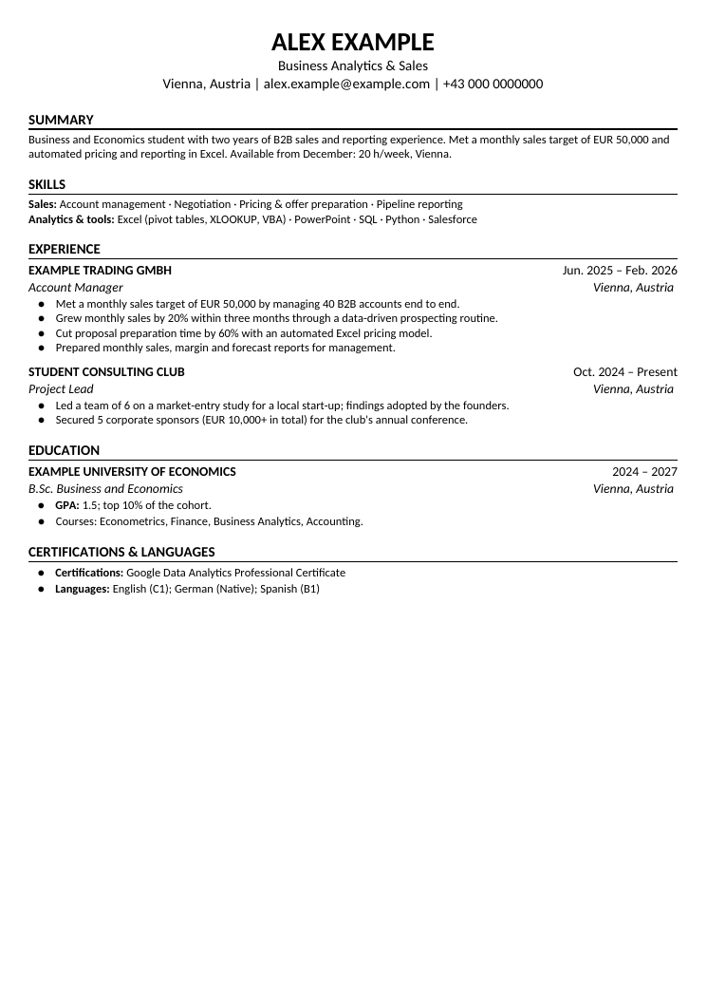

# cv_builder

Builds a **one-page CV** and a **cover letter** (DOCX + PDF) from a JSON spec in one consistent, ATS-friendly design.
The fonts, spacing, rules and bullets are copied from `resume_template.docx`. It checks the page count and your own
content rules. The [Claude Project workflow](../claude-project/README.md) writes the JSON for each job; you can also
write it by hand.

<p align="center"></p>

## Install

```bash
pip install -r cv_builder/requirements.txt     # python-docx (+ pypdf, optional)
# and LibreOffice for the PDF export: apt install libreoffice-writer  |  brew install --cask libreoffice
```

## Use

```bash
cp cv_builder/owner.example.json cv_builder/owner.json     # your name, contact line, file prefix, rules (git-ignored)
python3 cv_builder/cv_builder.py cv cv_builder/examples/cv_example.json out/
python3 cv_builder/cv_builder.py cl cv_builder/examples/cover_letter_example.json out/
python3 cv_builder/cv_builder.py check my_spec.json          # rules only, no files
```

Output: `out/<Prefix>_CV.docx` + `.pdf` (`--name` sets another file name). Exit codes: `0` ok, `3` longer than one
page, `4` a hard rule was broken.

## Your rules (`owner.json`)

```json
{
  "name": "Alex Example",
  "contact": "Vienna, Austria | alex@example.com | +43 …",
  "file_prefix": "Alex_Example",
  "rules":    [["linkedin\\.com", "my LinkedIn URL must never be in the documents"]],
  "warnings": [["\\bTableau\\b",  "skill I do not have yet"]]
}
```

`rules` are regexes that must never match (exit code 4). `warnings` only print a note. Built-in checks: CV bullets
in first person, bullets longer than about two lines, cover-letter length (target 250–330 words), and personal data
such as date of birth.

## Your own design

Edit `resume_template.docx` in Word or LibreOffice: change fonts, sizes, colours, margins and the heading rule. Do not
add, remove or reorder its paragraphs and tables. The builder uses them as prototypes by position (see the constants
`P_NAME`, `P_HEADING`, `P_BULLET`, … at the top of `cv_builder.py`).
