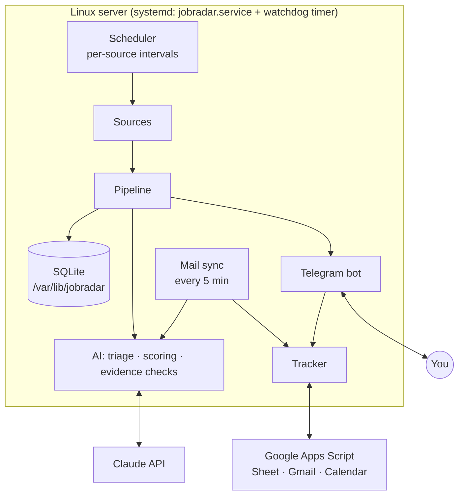

# Architecture

Job Radar is a single Python process (`python -m jobradar`) that runs as a systemd service. It uses an asyncio
event loop with the `python-telegram-bot` job queue as its scheduler, SQLite as its only database, and the Claude
API for all language work. It has no web server, no queue and no container. That makes a €5 server enough and
leaves very little to break.

## Code map

| Module | Responsibility |
|---|---|
| `jobradar/__main__.py` | Start-up: settings, logging, sources, bot |
| `config.py` | Loads `secrets.env`, `config.yaml`, `profile.md`; sets the search area |
| `sources/` | One adapter per source; each returns `RawJob`s (`models.py`) |
| `pipeline.py` | Ingest → dedupe → prefilter → triage → details → scoring → decision → delivery |
| `ai.py` | Every Claude call and prompt, plus the deterministic **evidence checks** |
| `bot.py` | Telegram commands, buttons, scheduled jobs (follow-ups 10:00, evening nudge 20:30, weekly report Sun 19:00, backup 04:00), health alerts |
| `telegram_ui.py` | Rendering of job cards and keyboards |
| `tracker.py`, `sheets.py` | Applications and follow-ups; sync with the Google Sheet through Apps Script |
| `mail.py`, `alerts.py` | Inbox classification; LinkedIn job-alert e-mails as a backup source |
| `links.py` | Best apply link (company site over job board), referral searches |
| `db.py` | SQLite schema and queries |
| `deploy/watchdog.py` | Separate timer (every 10 min): restarts a dead, stuck or bloated bot and alerts you |

## Sources

Every source implements `fetch(backfill) → list[RawJob]` and optionally `fetch_detail(raw)` for the full text.
They run on their own intervals, under a lock, in a thread (the HTTP code is synchronous).

- **LinkedIn** (`linkedin.py`): public guest endpoints only, never your account. A 3-hour window (search results
  lag behind postings), a keyword "sweep" at night, randomised delays, and back-off on HTTP 429
  (15 → 30 → 60 min). While LinkedIn is throttled, the pipeline looks for the same ad on the company's site instead
  of waiting.
- **Indeed** through [JobSpy](https://github.com/speedyapply/JobSpy). It often gives direct company links.
- **National boards** (`karriere.py`, `jobsat.py`, `willhaben.py`, `derstandard.py`, `zbp.py`): small HTML/JSON adapters.
- **Aggregator APIs** (`apis.py`: Jooble, Careerjet). They return snippets only, so `original.py` looks for the full
  posting (another source → the company's ATS → JOIN → a capped paid web search). Without the original, a job is
  sent only if it is clearly a student or part-time role.
- **Generic sites** (`sites.py`): list pages → detail pages with schema.org `JobPosting`. Configuration only.
- **Company ATS boards** (`boards.py`, `boards_extra.py`): 20 adapters (Workday, SuccessFactors, Greenhouse, Lever,
  Ashby, SmartRecruiters, Personio, Recruitee, Workable, Teamtailor, BambooHR, Breezy, Pinpoint, JOIN, Taleo,
  Amazon, UN Careers, OSCE, …). Boards are **learned** automatically from apply links seen elsewhere.

Each source reports to `source_health`. The bot alerts when a source fails N times in a row, hangs, or returns zero
jobs for 8 hours, which is how silent breakage (a site changed its HTML) shows up.

## Pipeline

1. **Ingest:** skip known IDs, ads older than `max_age_days`, and the backlog of brand-new sources (evaluated
   but delivered silently).
2. **Dedupe:** the same job reaches the bot from up to five sources. Matching uses a company+title
   fingerprint (45 days), title + description similarity, and, after scoring, a near-identical text check against
   everything already sent (catches recruiter re-posts under another company name).
3. **Prefilter:** `title_exclude` / `company_exclude` regexes, with no AI.
4. **Triage:** a cheap title-only Claude call. It may reject **only** with a category and the exact title words that
   prove it, checked by code. Hours, language, experience or location never decide here.
5. **Details:** full description and apply link.
6. **Scoring:** one structured-output Claude call: score, role type, hours, salary pro-rated to your hours, German
   requirement and quote, start, deadline, *why* / *risks* / *missing*, how to apply (which documents, cover letter
   wanted or not), stop factors with evidence.
7. **Decision and delivery:** hidden if a stop factor is proven, otherwise sent if `score ≥ min_score`. The card
   gets the best apply link, and in the background the bot looks for the posting on the company's own site and updates the card.

## AI scoring with evidence

The worst failure of an AI filter is the job you never see. Job Radar treats hiding a job as a claim that needs
proof:

- For every stop factor the model must copy a **verbatim quote** from the ad.
- `ai.verify_blockers` checks that the quote is really in the ad (`util.strict_quote`, tolerant only of spacing,
  case, umlaut spelling and ≤ 10% typos in long quotes) **and** that it says what is claimed:
  - *full-time:* Vollzeit / full-time / ≥ 35 h, with no part-time option of ≤ `max_weekly_hours` **for this job**.
    Part-time studies, parental part-time, "only in special cases" and "24h support" don't count as options.
    Salary "on a full-time basis" proves nothing for internships.
  - *German:* a level above B1 attached to German, not "a plus", not "German or English".
  - *senior:* 3+ years, "several years", or a lead/head role.
  - *expired:* a date in the quote before today. *Not in the area:* a place that is not your area and not remote.
- If a claim fails, the model is asked **once more**, with the exact reason. If it still cannot prove the claim, the
  claim is ignored and the job is delivered at the threshold with a "⚠️ The AI suspected … but the ad does not say
  so; check it yourself" note.
- If the model fills in hours above your maximum but claims nothing, code checks the ad text by itself.
- Malformed model answers are retried rather than used.

`tools/dev/replay_*.py` replays the checks on stored evaluations (no API cost). Use them to measure a rule change on
real history before deploying it.

## Data

SQLite at `/var/lib/jobradar/jobradar.sqlite3`:

| Table | Content |
|---|---|
| `jobs` | Every ad seen: source, IDs, fingerprint, text, stage (`sent`, `blocked`, `duplicate`, `below_threshold`, …), AI analysis (JSON), Telegram message ID |
| `boards` | Company ATS boards (seeded + learned) and their health |
| `applications` | The tracker (mirrors the Google Sheet) |
| `emails` | Processed e-mails and their classification |
| `feedback` | Your reactions and reasons (fed back into scoring) |
| `source_health`, `usage`, `kv` | Monitoring, AI spend per day, runtime settings |

Texts of unsent ads older than `keep_text_days` are pruned. The rows stay so duplicates are still detected. Backups
run nightly (7 kept).

## Security model

- Secrets live only in `secrets.env` on your PC and in `/etc/jobradar/secrets.env` (root:jobradar, 640) on the server.
- The service runs as an unprivileged `jobradar` user with systemd hardening (`ProtectSystem`, `ProtectHome`,
  `NoNewPrivileges`, `PrivateTmp`).
- The server accepts SSH keys only (passwords off), has the `ufw` firewall with SSH only, fail2ban and automatic
  security updates. It has no open web port: Telegram and Apps Script are reached outbound.
- Only the owner's chat ID can control the bot.
- The Apps Script web app checks a shared secret on every call.
